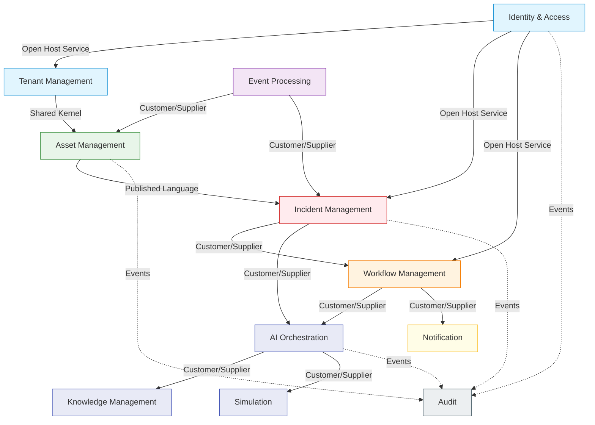

# AURA-X Phase 0 Domain Model

This document outlines the Domain Model for AURA-X, an AI-native operational intelligence and execution platform for Facilities & Field Operations, designed using Domain-Driven Design (DDD) principles.

## 1. Bounded Contexts

AURA-X is divided into the following Bounded Contexts to ensure clear separation of concerns, transactional boundaries, and team autonomy:

*   **Identity & Access Context:** Manages authentication, authorization, users, roles, and permissions across the platform.
*   **Tenant Management Context:** Handles multi-tenancy, organizations, subscriptions, billing, and tenant-level configurations.
*   **Asset Management Context:** The core structural domain. Manages physical and logical assets (buildings, sites, floors, rooms, zones), equipment, sensors, and IoT devices.
*   **Incident Management Context:** Manages the lifecycle of operational anomalies, issues, tickets, work orders, SLAs, and escalations.
*   **Workflow Management Context:** Defines and executes automated and human-in-the-loop processes (workflows, triggers, conditions, actions, approvals).
*   **Event Processing Context:** Ingests, normalizes, routes, and processes high-volume telemetry and system events in real-time.
*   **AI Orchestration Context:** Manages the execution, policies, state, tools, and permissions of autonomous AI agents.
*   **Knowledge Management Context:** Manages unstructured data, documents, vector embeddings, knowledge graphs, and evidence used by AI and human operators.
*   **Simulation Context:** Provides what-if analysis, plan simulations, impact analysis, and plan comparisons without affecting production state.
*   **Maintenance Context:** Manages preventive maintenance schedules, maintenance records, spare parts inventory, and technician/vendor assignments.
*   **Notification Context:** Handles delivery of alerts, emails, SMS, and in-app notifications.
*   **Audit Context:** Immutable ledger of all system actions, policy decisions, and security events.
*   **Analytics Context:** Data warehousing, reporting, dashboards, and historical operational metrics.

---

## 2. Domain Entities

### 2.1 Identity & Access Context
*   **User (Aggregate Root):** Represents a human or system actor.
    *   Attributes: `Id` (UUID), `Email` (String), `PasswordHash` (String), `Status` (Enum).
    *   Relationships: Belongs to 1..N `Tenant`s, has 1..N `Role`s.
*   **Role (Entity):** A named set of permissions.
    *   Attributes: `Id` (UUID), `Name` (String), `Description` (String).
    *   Relationships: Has 1..N `Permission`s.
*   **Permission (Value Object):** A specific access right (e.g., `incident:read`, `asset:write`).
    *   Attributes: `Resource` (String), `Action` (String).

### 2.2 Tenant Management Context
*   **Organization (Aggregate Root):** The top-level customer entity.
    *   Attributes: `Id` (UUID), `Name` (String), `Domain` (String).
    *   Relationships: Has 1..N `Tenant`s.
*   **Tenant (Entity):** An isolated workspace within an organization.
    *   Attributes: `Id` (UUID), `Name` (String), `Status` (Enum).
    *   Relationships: Has 1 `Subscription`.
*   **Subscription (Entity):** Billing and tier details.
    *   Attributes: `Id` (UUID), `PlanId` (UUID), `StartDate` (DateTime), `EndDate` (DateTime), `Status` (Enum).
*   **Plan (Entity):** Product tier definition.
    *   Attributes: `Id` (UUID), `Name` (String), `MaxUsers` (Int), `MaxAssets` (Int).

### 2.3 Asset Management Context
*   **Site (Aggregate Root):** A geographical location (e.g., a campus).
    *   Attributes: `Id` (UUID), `Name` (String), `Address` (Address VO).
    *   Relationships: Contains 1..N `Building`s.
*   **Building (Entity):** A structure within a site.
    *   Attributes: `Id` (UUID), `Name` (String).
    *   Relationships: Contains 1..N `Floor`s.
*   **Floor & Room & Zone (Entities):** Spatial divisions.
    *   Attributes: `Id` (UUID), `Name` (String), `Capacity` (Int).
*   **Asset (Aggregate Root):** A tracked piece of equipment or machinery.
    *   Attributes: `Id` (UUID), `Name` (String), `SerialNumber` (String), `Status` (Enum), `LocationId` (UUID).
    *   Relationships: Belongs to 1 `AssetType`, has 0..N `Sensor`s, has 0..N `MaintenanceSchedule`s.
*   **AssetType (Entity):** Categorization of assets (e.g., HVAC, Elevator).
    *   Attributes: `Id` (UUID), `Category` (String), `Manufacturer` (String).
*   **Sensor/Device (Entity):** Hardware emitting telemetry.
    *   Attributes: `Id` (UUID), `MacAddress` (String), `Protocol` (Enum).
*   **SensorReading (Value Object):** A single telemetry point.
    *   Attributes: `Timestamp` (DateTime), `Value` (Double), `Unit` (String).

### 2.4 Incident Management Context
*   **Incident (Aggregate Root):** An unplanned event or issue.
    *   Attributes: `Id` (UUID), `Title` (String), `Description` (String), `Severity` (Enum), `Status` (Enum), `CreatedAt` (DateTime), `AssetId` (UUID).
    *   Relationships: Has 1 `SLA`, has 0..N `WorkOrder`s.
*   **WorkOrder (Entity):** A specific task to resolve an incident.
    *   Attributes: `Id` (UUID), `Type` (Enum), `Status` (Enum), `AssignedTo` (UUID).
*   **SLA (Value Object):** Service Level Agreement details.
    *   Attributes: `ResolutionTimeTarget` (TimeSpan), `ResponseTimeTarget` (TimeSpan), `IsBreached` (Boolean).
*   **Escalation (Entity):** A rule defining what happens if SLAs are not met.
    *   Attributes: `Id` (UUID), `TriggerCondition` (String), `TargetRoleId` (UUID).

### 2.5 Workflow Management Context
*   **Workflow (Aggregate Root):** A defined business process.
    *   Attributes: `Id` (UUID), `Name` (String), `Status` (Enum), `Version` (Int).
    *   Relationships: Has 1..N `WorkflowStep`s, 1..N `Trigger`s.
*   **WorkflowStep (Entity):** A discrete unit of work in a workflow.
    *   Attributes: `Id` (UUID), `Type` (Enum), `Order` (Int).
    *   Relationships: Has 0..N `Condition`s, 1..N `Action`s.
*   **Trigger (Value Object):** Event that starts the workflow.
    *   Attributes: `EventType` (String), `Source` (String).
*   **Condition (Value Object):** Logic gate for step execution.
    *   Attributes: `Expression` (String).
*   **Action (Entity):** The operation to perform (e.g., send email, call API, invoke Agent).
    *   Attributes: `Id` (UUID), `ActionType` (Enum), `PayloadTemplate` (String).
*   **Approval (Entity):** Human-in-the-loop requirement.
    *   Attributes: `Id` (UUID), `ApproverId` (UUID), `Status` (Enum).

### 2.6 AI Orchestration Context
*   **Agent (Aggregate Root):** An autonomous or semi-autonomous AI actor.
    *   Attributes: `Id` (UUID), `Name` (String), `ModelConfig` (String), `Status` (Enum).
    *   Relationships: Belongs to 1 `AgentType`, has 0..N `ToolPermission`s.
*   **AgentType (Entity):** Categorization of agents (e.g., Triage, Diagnostic, Planner).
    *   Attributes: `Id` (UUID), `SystemPrompt` (String).
*   **Tool (Entity):** A capability an agent can use (e.g., query_db, search_docs).
    *   Attributes: `Id` (UUID), `Name` (String), `Endpoint` (String).
*   **ToolPermission (Value Object):** Grant of a tool to an agent.
    *   Attributes: `ToolId` (UUID), `AllowedParameters` (JSON).
*   **AgentExecution (Aggregate Root):** A specific run/session of an agent.
    *   Attributes: `Id` (UUID), `AgentId` (UUID), `ContextId` (UUID), `StartTime` (DateTime), `EndTime` (DateTime), `State` (JSON).

### 2.7 Knowledge Management Context
*   **Document (Aggregate Root):** An ingested file or text (manuals, standard operating procedures).
    *   Attributes: `Id` (UUID), `Title` (String), `SourceUri` (String), `Version` (String).
    *   Relationships: Has 1..N `Embedding`s, 1..N `KnowledgeNode`s.
*   **Embedding (Value Object):** Vector representation.
    *   Attributes: `Vector` (Array[Float]), `Model` (String).
*   **KnowledgeNode (Entity):** A semantic entity in the Knowledge Graph.
    *   Attributes: `Id` (UUID), `Label` (String), `Properties` (JSON).
*   **Evidence (Entity):** Links an AI decision to a Document/Node.
    *   Attributes: `Id` (UUID), `ExecutionId` (UUID), `DocumentId` (UUID), `RelevanceScore` (Float).

### 2.8 Simulation Context
*   **SimulationScenario (Aggregate Root):** Definition of a hypothetical situation.
    *   Attributes: `Id` (UUID), `Name` (String), `Parameters` (JSON).
*   **SimulationResult (Entity):** Output of a simulation run.
    *   Attributes: `Id` (UUID), `ScenarioId` (UUID), `Metrics` (JSON).
*   **Plan (Entity):** A proposed set of actions.
    *   Attributes: `Id` (UUID), `Steps` (JSON).
*   **PlanComparison (Entity):** Diff between two plans.
    *   Attributes: `Id` (UUID), `PlanAId` (UUID), `PlanBId` (UUID), `Diff` (JSON).

### 2.9 Maintenance Context
*   **MaintenanceSchedule (Aggregate Root):** Planned preventive maintenance.
    *   Attributes: `Id` (UUID), `AssetId` (UUID), `CronExpression` (String), `TaskDescription` (String).
*   **MaintenanceRecord (Entity):** Historical log of maintenance performed.
    *   Attributes: `Id` (UUID), `DatePerformed` (DateTime), `Cost` (Decimal), `TechnicianId` (UUID).
*   **Technician (Entity) / Vendor (Entity) / VendorContract (Entity):** Labor resources.
*   **SparePart (Entity) / InventoryItem (Entity):** Parts needed for maintenance.

### 2.10 Audit, Notification, Analytics Contexts (Brief)
*   **AuditRecord (Aggregate Root):** `Id`, `Timestamp`, `ActorId`, `Action`, `Resource`, `Diff`.
*   **Notification (Aggregate Root):** `Id`, `RecipientId`, `Channel` (Email/SMS/Push), `Message`, `Status`.
*   **PolicyDecision (Entity):** `Id`, `PolicyId`, `SubjectId`, `Decision` (Allow/Deny).

---

## 3. Context Map

The following Mermaid diagram illustrates the relationships between the Bounded Contexts.

---

## 4. Aggregate Design

### 4.1 Asset Aggregate
*   **Aggregate Root:** `Asset`
*   **Entities:** `Sensor`, `MaintenanceSchedule`
*   **Value Objects:** `SensorReading`, `LocationCoordinates`
*   **Invariants:**
    *   An Asset must belong to a valid Site and Building.
    *   Sensor MAC addresses must be unique within an Asset.
    *   Status transitions must follow valid state machine (e.g., Active -> UnderMaintenance -> Active).
*   **Domain Events Produced:** `AssetCreated`, `AssetStatusChanged`, `AssetRelocated`, `SensorAdded`, `TelemetryThresholdBreached`.

### 4.2 Incident Aggregate
*   **Aggregate Root:** `Incident`
*   **Entities:** `WorkOrder`, `Escalation`
*   **Value Objects:** `SLA`, `PriorityScore`
*   **Invariants:**
    *   An Incident cannot be Closed if there are Open WorkOrders.
    *   SLA breached flag must be evaluated on every status change or time tick.
    *   Severity cannot be lowered once an Escalation has fired, without Manager override.
*   **Domain Events Produced:** `IncidentRaised`, `IncidentAssigned`, `IncidentSeverityChanged`, `IncidentResolved`, `SlaBreached`, `WorkOrderCreated`, `WorkOrderCompleted`.

### 4.3 Workflow Aggregate
*   **Aggregate Root:** `Workflow`
*   **Entities:** `WorkflowStep`, `Action`, `Approval`
*   **Value Objects:** `Trigger`, `Condition`
*   **Invariants:**
    *   Workflow must have exactly one Start Trigger.
    *   Workflow graph must not contain infinite unyielding loops.
    *   A published Workflow version is immutable.
*   **Domain Events Produced:** `WorkflowCreated`, `WorkflowPublished`, `WorkflowExecutionStarted`, `WorkflowExecutionCompleted`, `WorkflowStepFailed`, `ApprovalRequested`, `ApprovalGranted`.

### 4.4 AgentExecution Aggregate
*   **Aggregate Root:** `AgentExecution`
*   **Entities:** `AgentState`, `ToolInvocation`
*   **Value Objects:** `ExecutionMetrics`, `TokenUsage`
*   **Invariants:**
    *   Execution cannot use tools not explicitly granted in `ToolPermission`.
    *   State must be persistable at every transition point.
    *   Execution must time out after a system-defined maximum duration.
*   **Domain Events Produced:** `AgentExecutionStarted`, `AgentExecutionPaused`, `AgentExecutionResumed`, `AgentExecutionCompleted`, `AgentExecutionFailed`, `ToolInvoked`, `ToolExecutionFailed`.

---

## 5. Domain Events

All domain events follow a standard envelope containing `EventId`, `Timestamp`, `CorrelationId`, and `TenantId`. Below are the specific payload details.

| Event Name | Source Context | Payload (Key Fields) | Consumer Contexts |
| :--- | :--- | :--- | :--- |
| `TenantCreated` | Tenant | `TenantId`, `Name`, `PlanId` | Identity, Asset, Audit |
| `SubscriptionUpgraded` | Tenant | `TenantId`, `OldPlanId`, `NewPlanId` | Analytics, Audit |
| `UserRegistered` | Identity | `UserId`, `Email`, `TenantId` | Notification, Audit |
| `UserRoleGranted` | Identity | `UserId`, `RoleId`, `GrantedBy` | Audit |
| `UserLoginFailed` | Identity | `UserId`, `IpAddress`, `Reason` | Security/Audit |
| `AssetCreated` | Asset | `AssetId`, `Type`, `LocationId` | Incident, Analytics |
| `AssetStatusChanged` | Asset | `AssetId`, `OldStatus`, `NewStatus`, `Reason` | Incident, Workflow, Simulation |
| `AssetDecommissioned` | Asset | `AssetId`, `Date` | Maintenance, Analytics |
| `SensorProvisioned` | Asset | `SensorId`, `AssetId`, `MacAddress` | Event Processing |
| `SensorReadingReceived` | Event Proc. | `SensorId`, `Value`, `Timestamp` | Asset, Analytics |
| `TelemetryThresholdBreached`| Event Proc. | `SensorId`, `AssetId`, `Metric`, `Value`, `Threshold` | Incident, Workflow |
| `IncidentRaised` | Incident | `IncidentId`, `AssetId`, `Severity`, `Title` | Workflow, Notification, AI |
| `IncidentAssigned` | Incident | `IncidentId`, `AssigneeId` | Notification, Audit |
| `IncidentSeverityChanged` | Incident | `IncidentId`, `OldSeverity`, `NewSeverity` | Workflow, Analytics |
| `IncidentResolved` | Incident | `IncidentId`, `ResolutionCode`, `TimeTaken` | Analytics, Knowledge |
| `SlaBreached` | Incident | `IncidentId`, `SlaType`, `OverageMinutes` | Workflow, Notification |
| `WorkOrderCreated` | Incident | `WorkOrderId`, `IncidentId`, `TaskType` | Maintenance, Notification |
| `WorkOrderCompleted` | Incident | `WorkOrderId`, `TechnicianId`, `Notes` | Incident, Analytics |
| `WorkflowPublished` | Workflow | `WorkflowId`, `Version` | Event Processing |
| `WorkflowExecutionStarted` | Workflow | `ExecutionId`, `WorkflowId`, `TriggerPayload` | Audit |
| `WorkflowStepFailed` | Workflow | `ExecutionId`, `StepId`, `Error` | Notification, Audit |
| `ApprovalRequested` | Workflow | `ApprovalId`, `ApproverId`, `Context` | Notification |
| `ApprovalGranted` | Workflow | `ApprovalId`, `ApproverId` | Workflow |
| `AgentExecutionStarted` | AI | `ExecutionId`, `AgentId`, `ContextId` | Audit, Analytics |
| `AgentExecutionCompleted` | AI | `ExecutionId`, `ResultSummary`, `TokenCount`| Workflow, Incident |
| `ToolInvoked` | AI | `ExecutionId`, `ToolId`, `Parameters` | Audit |
| `DocumentIngested` | Knowledge | `DocumentId`, `Source`, `NodeCount` | AI |
| `KnowledgeGraphUpdated` | Knowledge | `NodeId`, `Action` (Add/Update/Delete) | AI, Analytics |
| `SimulationRunCompleted` | Simulation | `SimulationId`, `ScenarioId`, `OutcomeScore`| AI, Analytics |
| `MaintenanceScheduled` | Maintenance| `ScheduleId`, `AssetId`, `Date` | Asset, Workflow |
| `MaintenanceCompleted` | Maintenance| `RecordId`, `AssetId`, `Cost` | Analytics, Asset |
