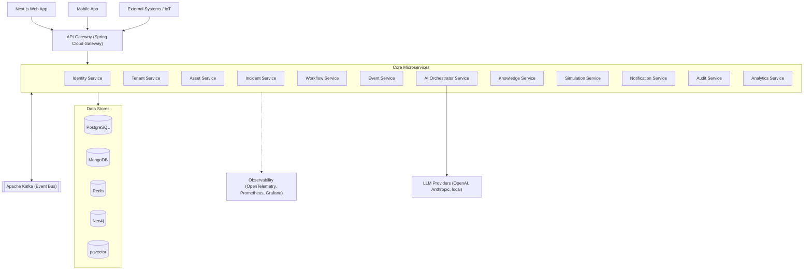
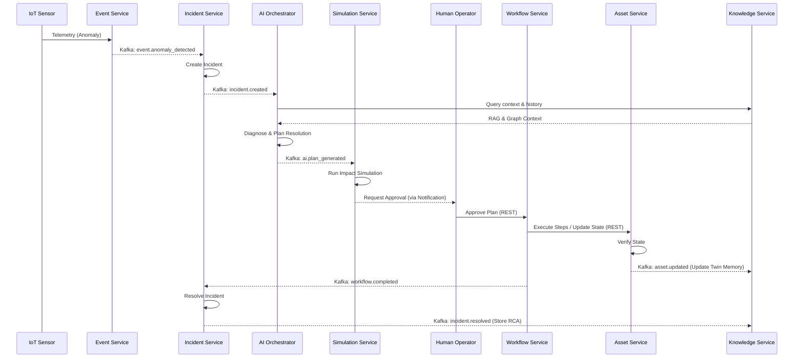

# AURA-X Phase 0 System Architecture

AURA-X is an AI-native operational intelligence and execution platform. This document outlines the Phase 0 system architecture, designed for high scalability, resilience, and extensibility through a microservices-based, event-driven approach.

## 1. High-Level Architecture

The architecture utilizes a microservices pattern with Spring Boot backends, a Next.js frontend, and a multi-polyglot persistence layer. Communication is facilitated by an API Gateway for synchronous client requests and Apache Kafka for asynchronous inter-service messaging.

## 2. Microservice Architecture

### 2.1 Identity Service
- **Responsibility**: Manages user authentication, authorization, OAuth2/OIDC flows, and JWT generation.
- **Primary Database**: PostgreSQL
- **Key APIs**: 
  - `POST /api/v1/auth/login`
  - `POST /api/v1/auth/refresh`
  - `GET /api/v1/users/me`
- **Kafka Produced**: `user.created`, `user.login`, `user.logout`
- **Kafka Consumed**: None
- **Dependencies**: Tenant Service
- **Technology**: Spring Boot, Spring Security, JWT, Redis (for token caching)

### 2.2 Tenant Service
- **Responsibility**: Multi-tenant lifecycle management, configuration, and tenant provisioning.
- **Primary Database**: PostgreSQL
- **Key APIs**:
  - `POST /api/v1/tenants`
  - `GET /api/v1/tenants/{id}`
  - `PUT /api/v1/tenants/{id}/config`
- **Kafka Produced**: `tenant.created`, `tenant.updated`
- **Kafka Consumed**: None
- **Dependencies**: None
- **Technology**: Spring Boot

### 2.3 Asset Service
- **Responsibility**: Digital twin and physical asset management, hierarchies, and metadata.
- **Primary Database**: PostgreSQL
- **Key APIs**:
  - `POST /api/v1/assets`
  - `GET /api/v1/assets/{id}`
  - `GET /api/v1/assets/{id}/hierarchy`
- **Kafka Produced**: `asset.created`, `asset.updated`, `asset.deleted`
- **Kafka Consumed**: `tenant.created`
- **Dependencies**: Tenant Service
- **Technology**: Spring Boot

### 2.4 Incident Service
- **Responsibility**: Incident lifecycle management, RCA, tracking resolutions.
- **Primary Database**: PostgreSQL
- **Key APIs**:
  - `POST /api/v1/incidents`
  - `GET /api/v1/incidents/{id}`
  - `PATCH /api/v1/incidents/{id}/status`
- **Kafka Produced**: `incident.created`, `incident.updated`, `incident.resolved`
- **Kafka Consumed**: `event.anomaly_detected`, `workflow.completed`
- **Dependencies**: Asset Service, AI Orchestrator Service
- **Technology**: Spring Boot

### 2.5 Workflow Service
- **Responsibility**: Execution engine for automated plans, human-in-the-loop approvals, and workflow orchestration.
- **Primary Database**: PostgreSQL
- **Key APIs**:
  - `POST /api/v1/workflows`
  - `GET /api/v1/workflows/{id}`
  - `POST /api/v1/workflows/{id}/approve`
- **Kafka Produced**: `workflow.started`, `workflow.step_completed`, `workflow.completed`, `workflow.failed`
- **Kafka Consumed**: `simulation.approved`, `incident.created`
- **Dependencies**: Simulation Service, Asset Service
- **Technology**: Spring Boot, Temporal/Camunda (Optional embed)

### 2.6 Event Service
- **Responsibility**: Ingests telemetry, IoT sensor data, and normalizes external events.
- **Primary Database**: MongoDB (TimeSeries)
- **Key APIs**:
  - `POST /api/v1/events/ingest`
- **Kafka Produced**: `event.raw`, `event.anomaly_detected`
- **Kafka Consumed**: None
- **Dependencies**: Asset Service
- **Technology**: Spring Boot, MongoDB

### 2.7 AI Orchestrator Service
- **Responsibility**: Core LLM orchestration, agentic coordination, context assembly, planning, and diagnosis.
- **Primary Database**: Redis (for context/session), pgvector
- **Key APIs**:
  - `POST /api/v1/ai/diagnose`
  - `POST /api/v1/ai/plan`
  - `POST /api/v1/ai/chat`
- **Kafka Produced**: `ai.analysis_complete`, `ai.plan_generated`
- **Kafka Consumed**: `incident.created`, `workflow.failed`
- **Dependencies**: Knowledge Service, LLM Providers
- **Technology**: Spring Boot, Spring AI / LangChain4j

### 2.8 Knowledge Service
- **Responsibility**: Manages unstructured data, RAG pipeline, semantic search, and the operational knowledge graph.
- **Primary Database**: pgvector (embeddings), Neo4j (graph)
- **Key APIs**:
  - `POST /api/v1/knowledge/documents`
  - `POST /api/v1/knowledge/search`
  - `GET /api/v1/knowledge/graph/{nodeId}`
- **Kafka Produced**: `knowledge.indexed`
- **Kafka Consumed**: `asset.created`, `incident.resolved`
- **Dependencies**: Asset Service
- **Technology**: Spring Boot

### 2.9 Simulation Service
- **Responsibility**: Simulates proposed execution plans (digital twin state transitions) to validate risk before execution.
- **Primary Database**: MongoDB (Simulation outputs)
- **Key APIs**:
  - `POST /api/v1/simulations`
  - `GET /api/v1/simulations/{id}`
- **Kafka Produced**: `simulation.completed`
- **Kafka Consumed**: `ai.plan_generated`
- **Dependencies**: Asset Service
- **Technology**: Spring Boot

### 2.10 Notification Service
- **Responsibility**: Delivers emails, SMS, push notifications, and WebSocket/SSE updates to clients.
- **Primary Database**: MongoDB (notification history)
- **Key APIs**:
  - `GET /api/v1/notifications`
  - `PATCH /api/v1/notifications/{id}/read`
- **Kafka Produced**: None
- **Kafka Consumed**: `*.created`, `*.updated`, `incident.*`, `workflow.*`
- **Dependencies**: None
- **Technology**: Spring Boot, WebSocket

### 2.11 Audit Service
- **Responsibility**: Immutable ledger of all significant platform activities, agent decisions, and user actions.
- **Primary Database**: MongoDB (Immutable collections)
- **Key APIs**:
  - `GET /api/v1/audit/logs`
- **Kafka Produced**: None
- **Kafka Consumed**: `*.*` (wildcard consumption)
- **Dependencies**: None
- **Technology**: Spring Boot

### 2.12 Analytics Service
- **Responsibility**: Aggregates operational metrics, generates dashboards, and batch processes historical data.
- **Primary Database**: PostgreSQL (OLAP) / ClickHouse
- **Key APIs**:
  - `GET /api/v1/analytics/dashboards/{id}`
  - `GET /api/v1/analytics/metrics`
- **Kafka Produced**: None
- **Kafka Consumed**: `*.*`
- **Dependencies**: Audit Service, Asset Service
- **Technology**: Spring Boot

## 3. Communication Patterns

- **Synchronous (REST via Gateway)**: Used for direct client-to-service requests (CRUD operations, querying state, immediate action triggers). The Gateway handles routing, authentication, and rate-limiting.
- **Asynchronous (Kafka Events)**: Used for service-to-service decoupling. When an entity changes state (e.g., incident created), an event is published. Subscribed services (e.g., Notification, Audit, Workflow) react independently, improving resilience and scale.
- **Real-time (WebSocket/SSE)**: Used by the Notification Service to push live updates (status changes, chat responses, alerting) to the Next.js frontend without client polling.

## 4. Data Flow Architecture

Signature Scenario: Sensor anomaly → Event ingestion → Incident creation → AI orchestration → Diagnosis → Risk → Planning → Simulation → Approval → Execution → Verification → Digital Twin update → Memory.

## 5. API Gateway Design

Built on **Spring Cloud Gateway**:
- **Routing Rules**: Path-based routing (e.g., `/api/v1/assets/**` → `asset-service`).
- **Rate Limiting**: Redis-based Token Bucket algorithm applied per tenant and per IP to prevent abuse.
- **Authentication Flow**: Gateway acts as an OAuth2 Resource Server. It validates the JWT signature and expiration before forwarding the request with `X-Tenant-ID` and `X-User-ID` headers.
- **CORS**: Globally configured at the gateway for the Next.js frontend domains.
- **Load Balancing**: Integrates with Kubernetes Service discovery to round-robin requests among healthy pods.

## 6. Security Architecture

- **OAuth2/OIDC**: Standard flows via Identity Service.
- **JWT Structure**: Claims include `sub` (user id), `roles` (global roles), `tenant_id`, and `permissions`.
- **RBAC & ABAC**: Role-Based Access Control for general permissions (e.g., `ROLE_ADMIN`); Attribute-Based Access Control for granular checks (e.g., user can only access assets in their physical facility).
- **Tenant Isolation**: Shared Database, Isolated Schema/Row-level. Each table has a `tenant_id` column, enforced automatically by Hibernate filters.
- **Agent Permission Matrix**: AI Agents are assigned service accounts with strict minimal permissions (e.g., Agent X can query `AssetService` but cannot mutate `UserService`).
- **API Security**: TLS 1.3 everywhere. Internal services require mTLS (via Service Mesh).

## 7. Observability Architecture

- **Distributed Tracing**: OpenTelemetry (OTel) agents in all Spring Boot apps, exporting to Jaeger or Grafana Tempo. Traces client requests across REST and Kafka hops.
- **Metrics**: Micrometer exporting to Prometheus (JVM metrics, HTTP latencies, Kafka lag).
- **Logging**: Logback outputs structured JSON logs. Shipped via Promtail to Grafana Loki.
- **Correlation IDs**: `traceId` injected at the Gateway and propagated via HTTP headers (`traceparent`) and Kafka headers to correlate all logs and traces.
- **Health Checks**: Spring Boot Actuator `/actuator/health` consumed by Kubernetes for liveness/readiness probes.

## 8. Resilience Patterns

- **Circuit Breakers**: Resilience4j implemented on REST clients (WebClient/Feign) to fail fast if a downstream service degrades.
- **Retries**: Exponential backoff for transient errors (e.g., network timeout to MongoDB).
- **Bulkheads**: Thread pool isolation to prevent a slow external API (e.g., LLM provider) from exhausting all Tomcat threads.
- **Rate Limiters**: At the Gateway and at the AI Orchestrator to manage token usage.
- **Fallbacks**: Providing degraded responses (e.g., returning cached asset data if the asset service is temporarily down).
- **Dead-Letter Queues (DLQ)**: Kafka consumer errors route messages to a DLQ topic for manual inspection and replay.

## 9. Deployment Architecture

- **Local Dev**: Docker Compose orchestrates the microservices, Kafka, Zookeeper/KRaft, Postgres, Redis, and Mongo.
- **Production**: Kubernetes (EKS/GKE/AKS).
- **Service Mesh**: Istio (optional) for mTLS, advanced traffic routing, and deep observability.
- **Scaling Strategy**: Horizontal Pod Autoscaling (HPA) based on CPU/Memory and KEDA (Kubernetes Event-driven Autoscaling) based on Kafka topic lag (particularly for the AI Orchestrator and Event Service).
