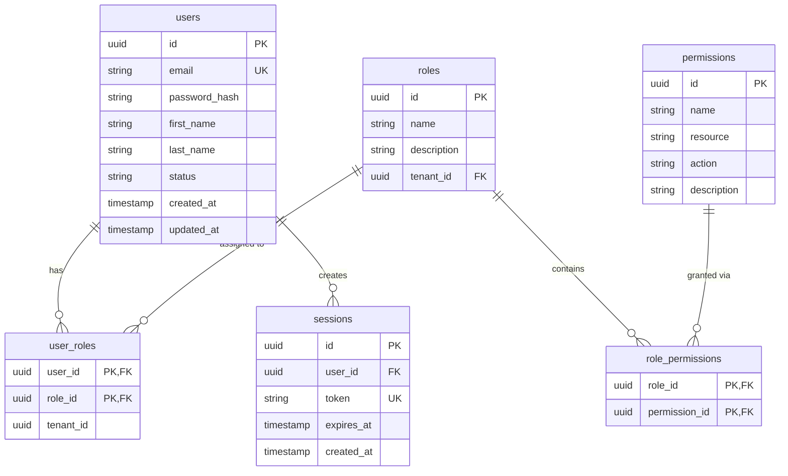
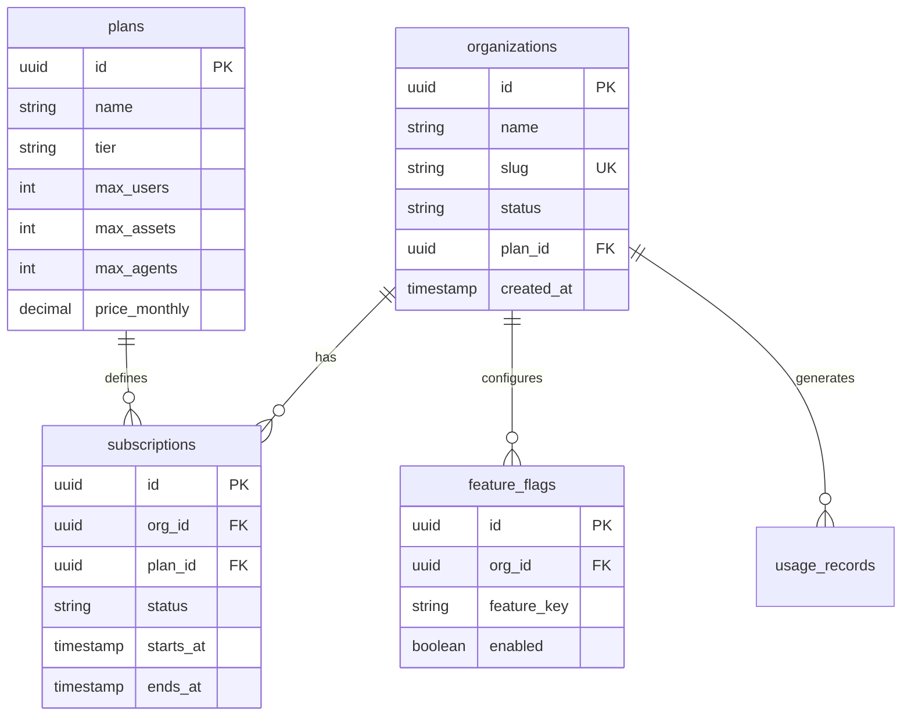
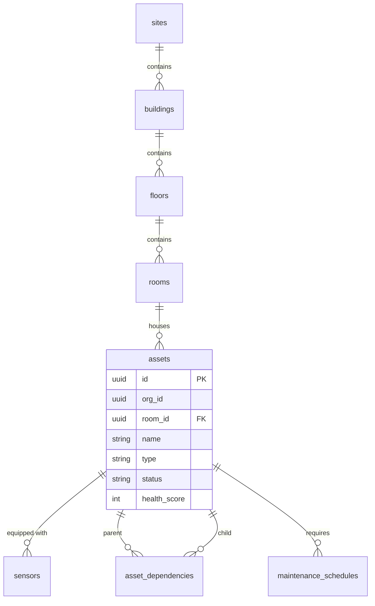
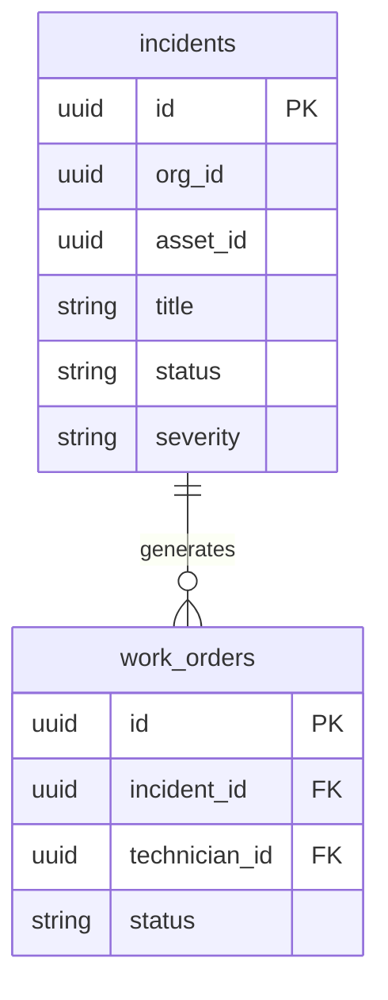
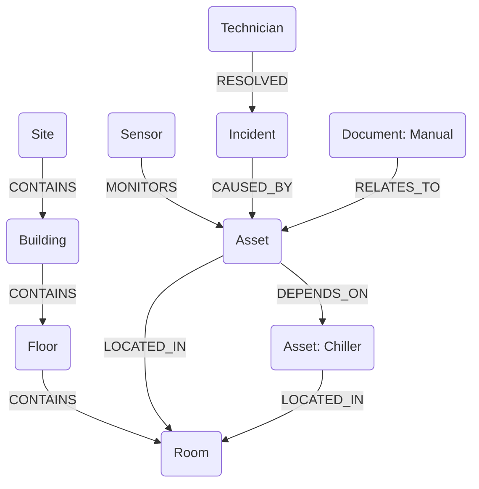

# AURA-X Phase 0: Database Architecture

This document details the polyglot persistence architecture for AURA-X — an AI-native operational intelligence and execution platform for Facilities & Field Operations.

AURA-X utilizes a polyglot persistence strategy to handle the diverse data requirements of the platform, leveraging PostgreSQL (relational, vector), MongoDB (document, timeseries), Redis (key-value, caching, pub/sub), and Neo4j (graph).

## 1. PostgreSQL Schema

PostgreSQL serves as the primary operational database for transactional services. We follow a database-per-service or schema-per-service pattern. Multi-tenancy is handled via row-level isolation (an `org_id` or `tenant_id` on almost every table).

### 1.1 Identity Service Schema (`identity_db`)

Manages users, roles, permissions, and sessions.



**Table: `users`**
*   `id` (UUID, PK, Default: `gen_random_uuid()`)
*   `email` (VARCHAR(255), NOT NULL, UNIQUE)
*   `password_hash` (VARCHAR(255), NOT NULL)
*   `first_name` (VARCHAR(100))
*   `last_name` (VARCHAR(100))
*   `status` (VARCHAR(20), Default: 'ACTIVE')
*   `created_at` (TIMESTAMPTZ, Default: `now()`)
*   `updated_at` (TIMESTAMPTZ, Default: `now()`)
*   **Indexes:** `idx_users_email`

**Table: `roles`**
*   `id` (UUID, PK, Default: `gen_random_uuid()`)
*   `name` (VARCHAR(100), NOT NULL)
*   `description` (TEXT)
*   `tenant_id` (UUID, NOT NULL) - *Tenant isolation*
*   **Indexes:** `idx_roles_tenant_id`
*   **Constraints:** UNIQUE (`name`, `tenant_id`)

**Table: `permissions`**
*   `id` (UUID, PK, Default: `gen_random_uuid()`)
*   `name` (VARCHAR(100), NOT NULL, UNIQUE)
*   `resource` (VARCHAR(100), NOT NULL)
*   `action` (VARCHAR(100), NOT NULL)
*   `description` (TEXT)

**Table: `role_permissions`**
*   `role_id` (UUID, PK, FK to `roles.id`, ON DELETE CASCADE)
*   `permission_id` (UUID, PK, FK to `permissions.id`, ON DELETE CASCADE)

**Table: `user_roles`**
*   `user_id` (UUID, PK, FK to `users.id`, ON DELETE CASCADE)
*   `role_id` (UUID, PK, FK to `roles.id`, ON DELETE CASCADE)
*   `tenant_id` (UUID, NOT NULL)

**Table: `sessions`**
*   `id` (UUID, PK, Default: `gen_random_uuid()`)
*   `user_id` (UUID, NOT NULL, FK to `users.id`, ON DELETE CASCADE)
*   `token` (VARCHAR(512), NOT NULL, UNIQUE)
*   `expires_at` (TIMESTAMPTZ, NOT NULL)
*   `created_at` (TIMESTAMPTZ, Default: `now()`)
*   **Indexes:** `idx_sessions_token`

---

### 1.2 Tenant Service Schema (`tenant_db`)

Manages organizations, subscriptions, and platform plans.



**Table: `organizations`**
*   `id` (UUID, PK, Default: `gen_random_uuid()`)
*   `name` (VARCHAR(255), NOT NULL)
*   `slug` (VARCHAR(255), NOT NULL, UNIQUE)
*   `status` (VARCHAR(50), Default: 'ACTIVE')
*   `plan_id` (UUID, FK to `plans.id`)
*   `created_at` (TIMESTAMPTZ, Default: `now()`)

**Table: `plans`**
*   `id` (UUID, PK, Default: `gen_random_uuid()`)
*   `name` (VARCHAR(100), NOT NULL)
*   `tier` (VARCHAR(50), NOT NULL)
*   `max_users` (INTEGER, Default: 0)
*   `max_assets` (INTEGER, Default: 0)
*   `max_agents` (INTEGER, Default: 0)
*   `price_monthly` (DECIMAL(10, 2))

**Table: `subscriptions`**
*   `id` (UUID, PK, Default: `gen_random_uuid()`)
*   `org_id` (UUID, NOT NULL, FK to `organizations.id`)
*   `plan_id` (UUID, NOT NULL, FK to `plans.id`)
*   `status` (VARCHAR(50), Default: 'ACTIVE')
*   `starts_at` (TIMESTAMPTZ, NOT NULL)
*   `ends_at` (TIMESTAMPTZ)
*   **Indexes:** `idx_subs_org_id`

**Table: `feature_flags`**
*   `id` (UUID, PK, Default: `gen_random_uuid()`)
*   `org_id` (UUID, NOT NULL, FK to `organizations.id`)
*   `feature_key` (VARCHAR(100), NOT NULL)
*   `enabled` (BOOLEAN, Default: FALSE)
*   **Constraints:** UNIQUE (`org_id`, `feature_key`)

**Table: `usage_records`**
*   `id` (UUID, PK, Default: `gen_random_uuid()`)
*   `org_id` (UUID, NOT NULL, FK to `organizations.id`)
*   `metric` (VARCHAR(100), NOT NULL)
*   `value` (INTEGER, NOT NULL)
*   `recorded_at` (TIMESTAMPTZ, Default: `now()`)
*   **Indexes:** `idx_usage_org_metric_date`

---

### 1.3 Asset Service Schema (`asset_db`)

Manages the spatial hierarchy and asset inventory. Tenant isolation via `org_id`.



**Table: `sites`**
*   `id` (UUID, PK), `org_id` (UUID, NOT NULL), `name` (VARCHAR), `address` (TEXT), `geo_location` (POINT), `status` (VARCHAR)
*   **Indexes:** `idx_sites_org_id`

**Table: `buildings`**
*   `id` (UUID, PK), `site_id` (UUID, NOT NULL, FK), `name` (VARCHAR), `floors_count` (INT), `status` (VARCHAR)

**Table: `floors`**
*   `id` (UUID, PK), `building_id` (UUID, NOT NULL, FK), `number` (INT), `name` (VARCHAR), `area_sqft` (DECIMAL)

**Table: `rooms`**
*   `id` (UUID, PK), `floor_id` (UUID, NOT NULL, FK), `name` (VARCHAR), `type` (VARCHAR), `capacity` (INT)

**Table: `assets`**
*   `id` (UUID, PK, Default: `gen_random_uuid()`)
*   `org_id` (UUID, NOT NULL) - *Tenant isolation*
*   `room_id` (UUID, FK to `rooms.id`)
*   `name` (VARCHAR(255), NOT NULL)
*   `type` (VARCHAR(100), NOT NULL) (e.g., HVAC, CHILLER, PUMP)
*   `model` (VARCHAR(100))
*   `manufacturer` (VARCHAR(100))
*   `serial_number` (VARCHAR(100))
*   `status` (VARCHAR(50), Default: 'OPERATIONAL')
*   `health_score` (INTEGER) (0-100)
*   `installed_at` (DATE)
*   `warranty_expires_at` (DATE)
*   **Indexes:** `idx_assets_org_id`, `idx_assets_room_id`

**Table: `sensors`**
*   `id` (UUID, PK), `asset_id` (UUID, NOT NULL, FK), `type` (VARCHAR) (e.g., TEMPERATURE, VIBRATION), `unit` (VARCHAR), `min_threshold` (DECIMAL), `max_threshold` (DECIMAL), `status` (VARCHAR)

**Table: `asset_dependencies`**
*   `parent_id` (UUID, PK, FK to `assets.id`)
*   `child_id` (UUID, PK, FK to `assets.id`)
*   `dependency_type` (VARCHAR(50)) (e.g., POWER, COOLING, LOGICAL)

**Table: `maintenance_schedules`**
*   `id` (UUID, PK), `asset_id` (UUID, NOT NULL, FK), `type` (VARCHAR) (e.g., PREVENTATIVE), `frequency` (INTERVAL), `next_due` (TIMESTAMPTZ), `last_performed` (TIMESTAMPTZ)

---

### 1.4 Incident Service Schema (`incident_db`)

Manages incidents, work orders, SLAs, and workforce (technicians/vendors).



**Table: `incidents`**
*   `id` (UUID, PK)
*   `org_id` (UUID, NOT NULL)
*   `asset_id` (UUID, FK)
*   `title` (VARCHAR(255), NOT NULL)
*   `description` (TEXT)
*   `severity` (VARCHAR(20)) (CRITICAL, HIGH, MEDIUM, LOW)
*   `priority` (INTEGER)
*   `status` (VARCHAR(50)) (OPEN, INVESTIGATING, RESOLVED, CLOSED)
*   `sla_deadline` (TIMESTAMPTZ)
*   `created_by` (UUID)
*   `assigned_to` (UUID)
*   `resolved_at` (TIMESTAMPTZ)
*   `created_at` (TIMESTAMPTZ, Default: `now()`)
*   **Indexes:** `idx_incidents_org_id`, `idx_incidents_status`

**Table: `work_orders`**
*   `id` (UUID, PK)
*   `incident_id` (UUID, NOT NULL, FK)
*   `type` (VARCHAR(50))
*   `description` (TEXT)
*   `status` (VARCHAR(50)) (DRAFT, SCHEDULED, IN_PROGRESS, COMPLETED)
*   `technician_id` (UUID, FK)
*   `scheduled_at` (TIMESTAMPTZ)
*   `completed_at` (TIMESTAMPTZ)

**Table: `sla_policies`**
*   `id` (UUID, PK), `org_id` (UUID, NOT NULL), `severity` (VARCHAR(20)), `response_time_minutes` (INT), `resolution_time_minutes` (INT)

**Table: `escalation_rules`**
*   `id` (UUID, PK), `org_id` (UUID, NOT NULL), `condition` (JSONB), `action` (VARCHAR), `target` (UUID)

**Table: `technicians`**
*   `id` (UUID, PK), `org_id` (UUID, NOT NULL), `user_id` (UUID, NOT NULL), `specialization` (VARCHAR[]), `availability_status` (VARCHAR), `current_location` (POINT)

**Table: `vendors`**
*   `id` (UUID, PK), `org_id` (UUID, NOT NULL), `name` (VARCHAR), `contact` (JSONB), `specialization` (VARCHAR[]), `rating` (DECIMAL)

**Table: `vendor_contracts`**
*   `id` (UUID, PK), `vendor_id` (UUID, FK), `org_id` (UUID, NOT NULL), `type` (VARCHAR), `starts_at` (DATE), `ends_at` (DATE), `value` (DECIMAL)

**Table: `spare_parts`**
*   `id` (UUID, PK), `org_id` (UUID, NOT NULL), `name` (VARCHAR), `part_number` (VARCHAR), `quantity` (INT), `min_stock` (INT), `location` (VARCHAR)

---

### 1.5 Workflow Service Schema (`workflow_db`)

Manages dynamic playbooks and automated workflows.

**Table: `workflows`**
*   `id` (UUID, PK), `org_id` (UUID, NOT NULL), `name` (VARCHAR), `description` (TEXT), `trigger_type` (VARCHAR), `status` (VARCHAR), `version` (INT)

**Table: `workflow_steps`**
*   `id` (UUID, PK), `workflow_id` (UUID, FK), `type` (VARCHAR), `config` (JSONB), `order` (INT), `next_step_id` (UUID)

**Table: `workflow_executions`**
*   `id` (UUID, PK), `workflow_id` (UUID, FK), `incident_id` (UUID), `status` (VARCHAR), `started_at` (TIMESTAMPTZ), `completed_at` (TIMESTAMPTZ)

**Table: `approvals`**
*   `id` (UUID, PK), `execution_id` (UUID, FK), `step_id` (UUID, FK), `approver_id` (UUID), `status` (VARCHAR), `requested_at` (TIMESTAMPTZ), `decided_at` (TIMESTAMPTZ), `reason` (TEXT)

---

### 1.6 Audit Service Schema (`audit_db`)

Immutable ledger for all critical actions, especially AI Agent decisions.

**Table: `audit_records`**
*   `id` (UUID, PK)
*   `org_id` (UUID, NOT NULL)
*   `actor` (VARCHAR) (User ID or Agent ID)
*   `actor_type` (VARCHAR) (USER, SYSTEM, AGENT)
*   `action` (VARCHAR) (e.g., RESOLVE_INCIDENT, APPROVE_WORK_ORDER)
*   `resource` (VARCHAR) (e.g., INCIDENT, ASSET)
*   `resource_id` (UUID)
*   `before_state` (JSONB)
*   `after_state` (JSONB)
*   `agent` (VARCHAR) (Name of the agent if actor_type=AGENT)
*   `model` (VARCHAR) (e.g., gpt-4o)
*   `tool` (VARCHAR) (Tool used by the agent)
*   `evidence` (JSONB) (Data points leading to the decision)
*   `policy` (VARCHAR) (Policy applied)
*   `approval_id` (UUID) (If human-in-the-loop was used)
*   `correlation_id` (UUID)
*   `timestamp` (TIMESTAMPTZ, Default: `now()`)
*   **Indexes:** `idx_audit_org_id_timestamp`, `idx_audit_resource_id`

---

### 1.7 Analytics Service Schema (`analytics_db`)

**Table: `kpi_snapshots`**
*   `id` (UUID, PK), `org_id` (UUID, NOT NULL), `metric` (VARCHAR), `value` (DECIMAL), `period` (VARCHAR) (DAILY, WEEKLY, MONTHLY), `recorded_at` (TIMESTAMPTZ)

---

## 2. MongoDB Collections

MongoDB is utilized for highly nested, unstructured, or time-series data where schema flexibility and rapid writes are required.

### AI Orchestrator Collections (`ai_orchestrator_db`)

*   **`agent_contexts`**: Stores the evolving memory and context window for agents.
    ```json
    {
      "_id": "ObjectId",
      "agent_id": "diagnostics-agent-01",
      "incident_id": "uuid",
      "short_term_memory": [{ "role": "user", "content": "..." }],
      "working_memory": { "hypothesis": "compressor failure", "confidence": 0.85 },
      "last_updated": "ISODate"
    }
    ```

*   **`agent_executions`**: Tracks the multi-step execution graphs of agents.
    ```json
    {
      "_id": "ObjectId",
      "correlation_id": "uuid",
      "status": "RUNNING",
      "steps": [
         { "step_id": 1, "action": "FETCH_TELEMETRY", "result": "success", "latency_ms": 120 }
      ],
      "started_at": "ISODate"
    }
    ```

*   **`execution_logs`**: Extremely detailed debug logs of LLM inputs/outputs.
    ```json
    {
      "_id": "ObjectId",
      "execution_id": "ObjectId",
      "prompt_tokens": 1250,
      "completion_tokens": 400,
      "raw_request": "...",
      "raw_response": "...",
      "timestamp": "ISODate"
    }
    ```

### Event Service Collections (`event_db`) (Time-Series)

*   **`sensor_readings`**: High-volume telemetry data (using MongoDB Time Series collections).
    ```json
    {
      "metadata": { "sensor_id": "uuid", "asset_id": "uuid", "org_id": "uuid" },
      "timestamp": "ISODate",
      "temperature": 72.5,
      "vibration_hz": 45
    }
    ```

*   **`device_payloads`**: Raw MQTT/IoT payloads for debugging and replay.
*   **`event_history`**: Domain events (e.g., AssetStatusChanged).

### Simulation Service Collections (`simulation_db`)

*   **`simulation_scenarios`**: Definition of what-if scenarios.
*   **`simulation_results`**: Output timelines from simulations.

---

## 3. Redis Usage

Redis is used for ephemeral data, caching, coordination, and high-speed pub/sub.

*   **Session Store**:
    *   Key Pattern: `session:user:{user_id}` or `session:token:{token}`
    *   TTL: 24 Hours
    *   Type: String / Hash
*   **Cache Patterns**:
    *   Asset Cache: `cache:asset:{asset_id}` (TTL: 1 Hour). Invalidated on asset update.
    *   Incident Cache: `cache:incident:{incident_id}` (TTL: 15 mins).
    *   Organization Config: `cache:org_config:{org_id}` (TTL: 24 Hours).
*   **Rate Limiting (Sliding Window)**:
    *   Key Pattern: `ratelimit:api:{org_id}:{endpoint}`
    *   Type: Sorted Set (ZSET storing timestamps).
*   **Distributed Locks**:
    *   Used to prevent concurrent agent executions on the same incident.
    *   Key Pattern: `lock:agent_exec:incident:{incident_id}`
    *   TTL: 30 seconds (with auto-renewal heartbeat).
*   **Temporary Agent State**:
    *   Fast access working memory during active inference cycles.

---

## 4. Neo4j Graph Model

Neo4j powers the Knowledge Graph, mapping the complex relationships between spatial topologies, assets, incidents, and documentation. This is critical for Root Cause Analysis (RCA) agents.

### Graph Schema

*   **Node Types**: `Organization`, `Site`, `Building`, `Floor`, `Room`, `Asset`, `Sensor`, `Incident`, `Technician`, `Vendor`, `Document`, `Evidence`, `Decision`, `KnowledgeItem`
*   **Relationship Types**:
    *   `[:LOCATED_IN]` (Asset -> Room, Room -> Floor)
    *   `[:CONTAINS]` (Site -> Building)
    *   `[:HAS_SENSOR]` (Asset -> Sensor)
    *   `[:MONITORS]` (Sensor -> Asset)
    *   `[:CAUSED_BY]` (Incident -> Asset, Incident -> Incident)
    *   `[:RESOLVED_BY]` (Incident -> Technician)
    *   `[:DEPENDS_ON]` (Asset -> Asset) (e.g., Server depends on CRAC Unit)
    *   `[:SUPPLIED_BY]` (Asset -> Vendor)
    *   `[:EVIDENCED_BY]` (Decision -> Evidence)
    *   `[:SIMILAR_TO]` (Incident -> Incident)
    *   `[:LED_TO]` (KnowledgeItem -> Decision)



### Sample Cypher Query (Blast Radius Analysis)
*Find all critical assets that depend on a failing HVAC unit:*
```cypher
MATCH (failing_hvac:Asset {id: $asset_id})-[:DEPENDS_ON*1..3]->(downstream:Asset)
WHERE downstream.criticality = 'HIGH'
RETURN downstream.name, downstream.room_id
```

---

## 5. pgvector Schema

PostgreSQL with the `pgvector` extension is used to store embeddings for semantic search and Retrieval-Augmented Generation (RAG).

**Table: `knowledge_embeddings`**
*   `id` (UUID, PK)
*   `org_id` (UUID, NOT NULL)
*   `content` (TEXT) (The text chunk being embedded)
*   `embedding` (vector(1536)) (Assuming OpenAI `text-embedding-3-small`)
*   `source_type` (VARCHAR) (DOCUMENT, INCIDENT_NOTES, MAINTENANCE_RECORD)
*   `source_id` (UUID) (FK to the original source)
*   `metadata` (JSONB) (Tags, page numbers, authors)
*   `created_at` (TIMESTAMPTZ, Default: `now()`)

### Indexing Strategy
For `pgvector`, we use the **HNSW (Hierarchical Navigable Small World)** index. HNSW provides significantly faster query performance and higher recall than IVFFlat, especially as the knowledge base grows.

```sql
CREATE INDEX idx_embeddings_hnsw ON knowledge_embeddings 
USING hnsw (embedding vector_cosine_ops);
```

---

## 6. Data Migration Strategy

To ensure production-grade schema evolution and CI/CD compatibility:

### 6.1 PostgreSQL Migrations (Flyway)
*   **Tool**: Flyway
*   **Convention**: `V{Version}__{Description}.sql` (e.g., `V1.0.1__create_assets_table.sql`)
*   Migrations are strictly forward-only. Rollbacks are handled via "fix-forward" scripts (`V1.0.2__fix_assets_column.sql`) rather than destructive down migrations in production.
*   Schema validations run on startup.

### 6.2 MongoDB Migrations (Mongock)
*   **Tool**: Mongock (for Java/Spring Boot ecosystems).
*   **Use Case**: Index creation, bulk data transformations, setting up time-series collection configurations, and schema validation rule updates.
*   Executed via Java ChangeLog classes.

### 6.3 Graph & Vector Resyncs
*   **Neo4j**: Graph structure is predominantly event-driven. A "Graph Resync Tool" (Idempotent replay of domain events) is maintained to rebuild the graph from PostgreSQL state if necessary.
*   **Vector DB**: Background jobs handle chunking and embedding generation. A `re-embed` flag can be triggered to regenerate embeddings if the embedding model is upgraded.
