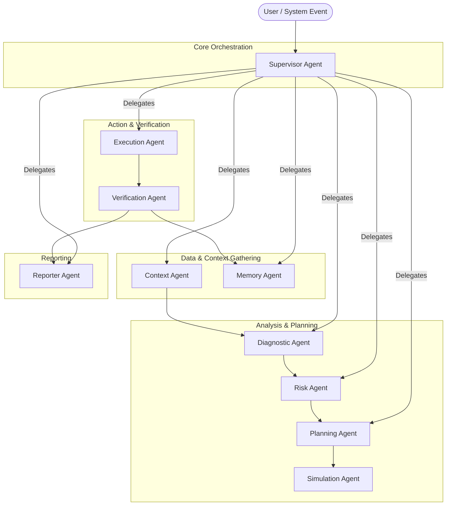
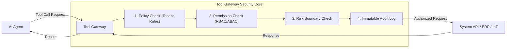
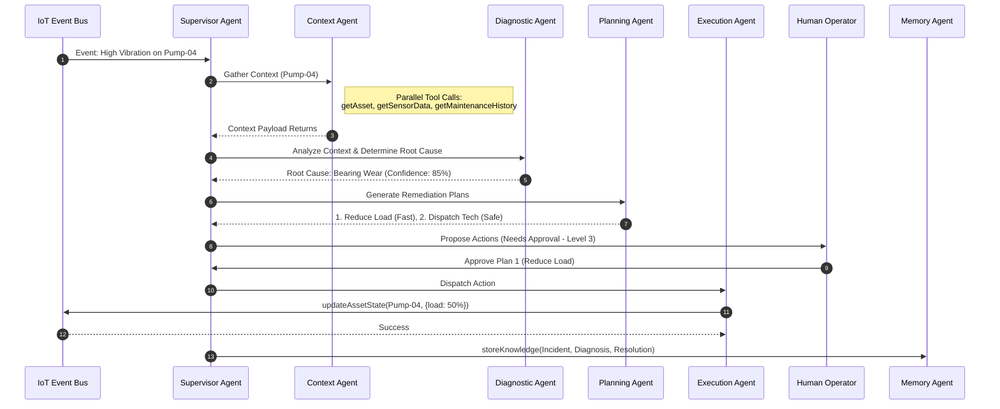

# AURA-X Phase 0 AI & Agent Architecture

This document defines the comprehensive AI-native operational intelligence and execution platform architecture for AURA-X. It outlines the multi-agent system, tool gateway, autonomy levels, Spring AI integrations, state management, and explainability mechanisms.

---

## 1. Multi-Agent Architecture Overview

AURA-X utilizes a multi-agent system orchestrated through a central supervisor. This "Supervisor-Worker" model ensures clear responsibility, bounded context, and structured delegation.

### Agent Roster

1. **Supervisor Agent** — Understands intent, decomposes problems, delegates to specialists, and coordinates results.
2. **Context Agent** — Retrieves operational context (assets, incidents, history, sensors, relationships).
3. **Diagnostic Agent** — Performs root cause analysis, telemetry analysis, and confidence scoring.
4. **Risk Agent** — Calculates operational, financial, and safety risk; determines blast radius and SLA impacts.
5. **Planning Agent** — Generates multiple action plans with cost/time/risk tradeoffs.
6. **Simulation Agent** — Simulates plans, performs what-if analysis, and predicts impact.
7. **Execution Agent** — Executes approved actions through controlled, permitted tools.
8. **Verification Agent** — Verifies execution outcomes match expectations.
9. **Reporter Agent** — Generates evidence-backed, human-readable reports.
10. **Memory Agent** — Stores organizational knowledge from resolved incidents.

### Multi-Agent Interaction Flow



---

## 2. Agent Design

### 2.1 Supervisor Agent
- **Purpose**: Central orchestrator. Understands intent, decomposes problems, delegates tasks, and coordinates state.
- **Input Schema**: User prompts, system events, alerts.
- **Output Schema**: Execution plans, final recommendations, delegated task configurations.
- **Tools**: `executeWorkflow`, `createApproval`, `sendNotification`.
- **Risk Level**: Level 1 (Plans and prepares, but does not act autonomously).
- **Prompt Principles**: Emphasize strict adherence to workflow sequencing, concise task delegation, avoiding assumptions, and objective aggregation of sub-agent responses.
- **Failure Modes**: Misinterpreting user intent (fallback to clarify), orchestration timeouts (retry).
- **Dependencies**: All other agents.

### 2.2 Context Agent
- **Purpose**: Retrieve and structure operational context.
- **Input Schema**: `entityId`, `entityType`, `timeRange`.
- **Output Schema**: Structured JSON graph of assets, relationships, recent telemetry, and active incidents.
- **Tools**: `getAsset`, `getAssetsByLocation`, `getSensorData`, `getIncident`, `getMaintenanceHistory`, `getVendorContract`.
- **Risk Level**: Level 0 (Read-only).
- **Prompt Principles**: Emphasize temporal relevance, relationship traversal, and data completeness.
- **Failure Modes**: API rate limits (exponential backoff), incomplete graphs (mark as degraded context).
- **Dependencies**: None.

### 2.3 Diagnostic Agent
- **Purpose**: Perform root cause analysis and assign confidence scores.
- **Input Schema**: Anomaly description, Context output (telemetry, history).
- **Output Schema**: List of potential root causes with `confidenceScore`, `evidenceList`, `severity`.
- **Tools**: `searchSimilarIncidents`, `searchKnowledge`.
- **Risk Level**: Level 0 (Analytical).
- **Prompt Principles**: Emphasize scientific method, evidence-based reasoning, and explicit acknowledgment of uncertainty.
- **Failure Modes**: Hallucinated root causes (mitigated by strict evidence mapping).
- **Dependencies**: Context Agent, Memory Agent.

### 2.4 Risk Agent
- **Purpose**: Quantify operational, financial, and safety risks.
- **Input Schema**: Asset status, proposed actions, failure scenarios.
- **Output Schema**: `RiskProfile` (Safety Risk, Financial Risk, Blast Radius, SLA Violations).
- **Tools**: None (Relies on data provided in context).
- **Risk Level**: Level 0 (Analytical).
- **Prompt Principles**: Worst-case scenario evaluation, conservative estimation, strict adherence to enterprise risk matrices.
- **Failure Modes**: Underestimating blast radius (mitigated by conservative bias).
- **Dependencies**: Context Agent, Diagnostic Agent.

### 2.5 Planning Agent
- **Purpose**: Generate multiple execution plans balancing cost, time, and risk.
- **Input Schema**: Root cause diagnosis, Risk profile, Goal.
- **Output Schema**: 3 actionable plans (Fastest, Safest, Most Cost-Effective) detailing steps and required tools.
- **Tools**: `getTechnicianAvailability`, `checkInventory`.
- **Risk Level**: Level 1 (Action preparation).
- **Prompt Principles**: Focus on concrete action steps, resource availability, and parallel vs. sequential execution paths.
- **Failure Modes**: Proposing impossible actions (mitigated by pre-checking resource tools).
- **Dependencies**: Diagnostic Agent, Risk Agent.

### 2.6 Simulation Agent
- **Purpose**: Perform what-if analysis and predict plan impacts.
- **Input Schema**: Proposed Action Plan.
- **Output Schema**: Simulated outcomes, estimated downtime, side-effect predictions.
- **Tools**: `runSimulation`.
- **Risk Level**: Level 0 (Read-only/Simulation).
- **Prompt Principles**: Logical deduction of state changes, physics/mechanics-based reasoning for physical assets.
- **Failure Modes**: Simulation drift (timeout handling).
- **Dependencies**: Planning Agent.

### 2.7 Execution Agent
- **Purpose**: Safely execute approved plans through controlled tool usage.
- **Input Schema**: Approved Action Plan, Action Parameters.
- **Output Schema**: Execution transaction logs, tool response payloads.
- **Tools**: `createIncident`, `assignTechnician`, `scheduleMaintenance`, `updateAssetState`.
- **Risk Level**: Level 2-4 (Action execution, bounded by gateway policies).
- **Prompt Principles**: Strict adherence to parameterized instructions, stop on first tool failure, no deviations.
- **Failure Modes**: Tool failure/timeout (requires automated rollback or human escalation).
- **Dependencies**: Supervisor Agent, Approval Workflow.

### 2.8 Verification Agent
- **Purpose**: Verify outcomes match simulated expectations.
- **Input Schema**: Executed Plan, Expected Outcomes.
- **Output Schema**: `VerificationStatus` (SUCCESS, PARTIAL, FAILURE), detailed telemetry diffs.
- **Tools**: `verifyOutcome`, `getSensorData`.
- **Risk Level**: Level 0 (Analytical).
- **Prompt Principles**: Skepticism, reliance on fresh telemetry, binary validation where possible.
- **Failure Modes**: Premature verification (handling temporal delays in telemetry).
- **Dependencies**: Execution Agent.

### 2.9 Reporter Agent
- **Purpose**: Generate localized, human-readable, evidence-backed reports.
- **Input Schema**: Entire incident context, execution logs, verification status.
- **Output Schema**: Markdown/PDF summaries, executive briefs.
- **Tools**: None.
- **Risk Level**: Level 0 (Read-only).
- **Prompt Principles**: Tone adaptation (executive vs technical), brevity, strict mapping of claims to evidence.
- **Failure Modes**: Formatting errors (strict JSON schema output enforcement).
- **Dependencies**: All Agents.

### 2.10 Memory Agent
- **Purpose**: Store and retrieve organizational knowledge.
- **Input Schema**: Verified incident resolution, lessons learned.
- **Output Schema**: Vectorized knowledge artifacts.
- **Tools**: `storeKnowledge`, `searchKnowledge`.
- **Risk Level**: Level 0 (Internal knowledge modification).
- **Prompt Principles**: Abstraction of specific incidents into generalized patterns, extraction of high-value heuristics.
- **Failure Modes**: Storing poor quality data (mitigated by quality scoring gate).
- **Dependencies**: Verification Agent, Reporter Agent.

---

## 3. AI Tool Gateway

The AI Tool Gateway acts as a strict, centralized proxy between Agents and the actual system APIs. It applies RBAC, Risk Policies, and Audit logging before any execution.

### Tool Registry

| Name | Description | Input Schema | Output Schema | Perms | Risk | Allowed Agents | Audit Req |
|------|-------------|--------------|---------------|-------|------|----------------|-----------|
| `getAsset` | Get asset details | `{assetId: string}` | `{id, name, type, status, ...}` | `read:asset` | 0 | Context | Low |
| `getAssetsByLocation` | List assets | `{locationId: string}` | `[{asset}]` | `read:asset` | 0 | Context | Low |
| `getSensorData` | Telemetry read | `{sensorId, timeRange}` | `[{timestamp, value}]` | `read:telemetry` | 0 | Context, Verif. | Low |
| `searchSimilarIncidents` | RAG on incidents | `{description, limit}` | `[{incidentId, score}]` | `read:incident` | 0 | Diagnostic | Low |
| `getIncident` | Read incident | `{incidentId}` | `{id, status, ...}` | `read:incident` | 0 | Context | Low |
| `getMaintenanceHistory`| Get work orders | `{assetId}` | `[{workOrderId, date}]` | `read:maintenance` | 0 | Context | Low |
| `getTechnicianAvailability`| List techs | `{specialization}` | `[{techId, available}]` | `read:personnel` | 0 | Planning | Low |
| `checkInventory` | Stock status | `{partNumber}` | `{inStock, location}` | `read:inventory` | 0 | Planning | Low |
| `getVendorContract` | Contract details | `{vendorId}` | `{id, SLAs, contact}` | `read:contract` | 0 | Context | Med |
| `searchKnowledge` | KB lookup | `{query}` | `[{title, snippet}]` | `read:kb` | 0 | Diagnostic, Mem | Low |
| `createIncident` | Open ticket | `{details: object}` | `{incidentId}` | `write:incident` | 1 | Execution | High |
| `assignTechnician` | Dispatch worker | `{incidentId, techId}` | `{status: boolean}` | `write:personnel` | 2 | Execution | High |
| `scheduleMaintenance` | Book work | `{assetId, details}` | `{scheduleId}` | `write:maintenance`| 2 | Execution | High |
| `createApproval` | Request Auth | `{details}` | `{approvalId}` | `write:approval` | 1 | Supervisor | High |
| `sendNotification` | Ping users | `{channel, msg}` | `{status}` | `write:notify` | 1 | Supervisor | Med |
| `runSimulation` | Sim action | `{scenario}` | `{predictions}` | `exec:simulation` | 0 | Simulation | Med |
| `executeWorkflow` | Trigger workflow | `{workflowId, params}`| `{executionId}` | `exec:workflow` | 3 | Execution | Critical |
| `verifyOutcome` | Check results | `{incidentId, expects}`| `{verified: bool}` | `read:telemetry` | 0 | Verification | Med |
| `updateAssetState` | Change status | `{assetId, state}` | `{success}` | `write:asset` | 4 | Execution | Critical |
| `storeKnowledge` | Save memory | `{knowledge}` | `{docId}` | `write:kb` | 1 | Memory | High |

### Tool Gateway Architecture



---

## 4. Risk-Based Autonomy System

AURA-X enforces varying degrees of autonomy depending on the computed risk of an action.

### The 5 Autonomy Levels
- **Level 0 (Advisory Only):** AI can read data and recommend actions. Humans must initiate tools.
- **Level 1 (Preparation):** AI can prepare actions, draft work orders, and generate tickets, but a human must click "Submit".
- **Level 2 (Low-Risk Automation):** AI can execute predefined low-risk actions automatically (e.g., restarting a non-critical edge gateway, acknowledging an informational alert).
- **Level 3 (Human-in-the-Loop for High Risk):** AI proposes medium/high-risk actions and routes an Approval Workflow to a human. Executes automatically *only after* human signs off.
- **Level 4 (Bounded Autonomous Execution):** AI operates entirely autonomously within predefined policy boundaries (e.g., "Balance pump loads on cooling array A as long as flow rate stays > 500 GPM").

### Risk Calculation Mechanism
Risk is computed dynamically per action via the **Risk Agent**:
`Action Risk Score = (Asset Criticality * Action Impact) + Blast Radius Penalty - Mitigation Factors`
- **Asset Criticality**: Fetched from asset context (1-10).
- **Action Impact**: Fetched from Tool Registry configuration.
- **Thresholds**: Defined per tenant. E.g., `Risk Score < 20` = Auto-Level 2; `Risk Score 21-80` = Level 3; `> 80` = Requires manual human execution.

---

## 5. Agent Execution Flow (Signature Scenario)

**Scenario**: Anomaly detected on critical Cooling Pump.



---

## 6. Spring AI Integration

AURA-X leverages **Spring AI** as the core framework for agent LLM abstraction.

### Key Configurations
- **ChatClient Configuration**: We use Spring AI's unified `ChatClient` builder. This allows us to swap LLM providers (OpenAI, Anthropic, Ollama for on-prem fallback) seamlessly.
- **Function Calling**: All tools in the Tool Gateway are registered as Spring `@Bean` implementations of `java.util.function.Function`. Spring AI handles automatic tool binding and JSON schema generation.
- **Model Abstraction**: Multi-model routing.
  - *Supervisor*: GPT-4o / Claude 3.5 Sonnet (High intelligence).
  - *Context/Reporter*: GPT-4o-mini (Fast, low cost).
  - *Memory*: Specialized embedding models (text-embedding-3-small).
- **Streaming**: System utilizes Spring's `Flux<String>` to stream supervisor thoughts to the UI in real-time.
- **Token & Rate Limiting**: Interceptors injected into `ChatClient` intercept requests, check tenant quota in Redis, and throw `RateLimitExceededException` before calling the LLM.

---

## 7. Agent State Management

Agent executions are long-running and stateful, mapped to a `ConversationId` or `IncidentId`.

### Lifecycle States
- **CREATED**: Request received, agents initializing.
- **RUNNING**: Agent actively processing or waiting for LLM.
- **WAITING**: Paused execution (e.g., waiting for Level 3 human approval, or external async system).
- **COMPLETED/FAILED**: Terminal states.

### Persistence & Reliability
- **Storage**: MongoDB stores agent states, structured outputs, and the event log (event sourcing).
- **Timeout Handling**: Supervisor imposes strict timeouts (e.g., 30s per sub-agent). If an agent fails to respond, the supervisor retries or falls back to a degraded plan.
- **Compensation Logic**: If an execution step fails halfway, the Execution Agent triggers predefined compensating tool calls (e.g., rolling back an asset state change).

---

## 8. AI Decision Explainability

AURA-X guarantees that every AI decision is auditable and explainable.

### The Evidence Chain
Every recommendation is linked to a JSON object called the `EvidenceChain`:
```json
{
  "recommendation": "Dispatch Technician to Pump-04",
  "evidence": [
    {
      "type": "TELEMETRY",
      "source": "sensor-vib-04",
      "value": "12.4 mm/s",
      "threshold": "8.0 mm/s"
    },
    {
      "type": "HISTORICAL_INCIDENT",
      "source": "INC-8891",
      "reasoning": "Identical vibration signature led to catastrophic failure in 2023."
    }
  ]
}
```

### Rendering "Why?"
The UI provides an "Explain" button next to any AI action. Clicking it renders the Evidence Chain using a graphical tree, mapping the final decision backward through the Planning Agent, Diagnostic Agent, and raw Context Agent data. 

---

## 9. Organizational Memory Design

The Memory Agent creates a continuously improving "brain" for the facility.

- **What gets stored**: `{ Incident Synopsis, Root Cause, Chosen Action, Final Outcome (Success/Fail) }`.
- **Similarity Search**: Incidents are vectorized. When a new anomaly occurs, the Diagnostic Agent queries the Vector DB using the anomaly description to find mathematically similar past events.
- **Quality Scoring**: Memories are ranked by the Verification Agent. If a past action failed, it is stored as an *anti-pattern* ("Do NOT do this").
- **Lifecycle**: Stale memories (> 5 years) are decayed in weight unless re-validated.

---

## 10. MCP-Ready Tool Architecture

To ensure future-proofing, AURA-X implements tools mirroring the **Model Context Protocol (MCP)** specification.

- **Tool Definition**: Tools define themselves via a standard schema (name, description, strictly typed JSON schema for inputs).
- **Discovery**: Agents can query a `/v1/tools/discover` endpoint via the Tool Gateway to dynamically understand available tools, allowing hot-plugging of new external integrations without code changes to the Agents.
- **Versioning**: Tool schemas are strictly versioned (e.g., `updateAssetState_v2`). The Gateway maps the agent's intent to the appropriate API version.
